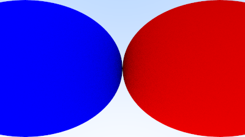

building a ray tracer from scratch following peter shirley's ray tracing in one weekend.

currently on the second book "ray tracing the next week"

## latest render

<!-- update-zone -->


*`renders/wide_angle_view.png` -- updated 2026-10-21*
<!-- /update-zone -->

## features

- vec3 math library (vector arithmetic, dot/cross product, unit vectors)
- ray class with origin/direction and parameterized point evaluation
- camera with configurable FOV, aperture, and focus distance
- antialiasing via multi-sample averaging
- diffuse (lambertian), metal, and dielectric (glass) materials
- positionable camera with depth-of-field blur
- rays carry a time value, the groundwork for motion blur from the second book
- adding more features to it

## build

```
cmake -S . -B build
cmake --build build
```

compiles with `g++ -std=c++17 -O2` through CMake.

## render

```
./build/raytracer > renders/output.ppm && magick renders/output.ppm renders/output.png
```
